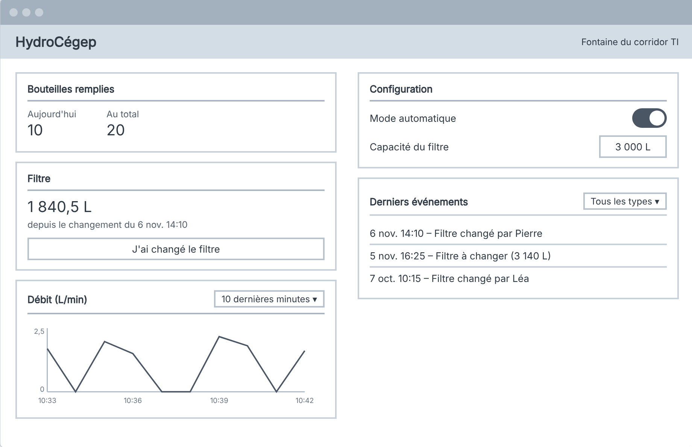

# Préparation à l'examen - NoSQL

## Mise en situation

La fontaine de remplissage de bouteilles du corridor du département TI est très utilisée et son filtre s'use plus vite que prévu. Le service des installations veut la suivre à distance.

Un débitmètre installé dans la fontaine est branché à un Raspberry Pi, qui :

- enregistre chaque minute le débit d'eau (L/min), même s'il est nul ;
- enregistre chaque bouteille remplie : quand l'eau coule puis s'arrête, il note l'heure et le volume versé ;
- compte les litres passés dans le filtre depuis son dernier changement ;
- déclenche une alerte quand ce nombre dépasse le seuil configuré et, en mode automatique, coupe l’eau de la fontaine.

Tous les techniciens d'entretien sont responsables de la fontaine et ont accès à tout son historique. Depuis l'application, un technicien peut :

- activer ou désactiver le mode automatique et modifier le seuil d'alerte ;
- indiquer qu'il a changé le filtre, ce qui remet le compteur à zéro.

Les changements de filtre et les alertes sont conservés dans l'historique. Une seule fontaine est installée : `hydrocegep-01`.

## Partie 1 - Modélisation (`modele.md`)

À partir de la mise en situation et de la maquette, donnez un exemple de document pour chaque collection, écrit en Python (dictionnaire), avec des valeurs réalistes.

Sous chaque exemple, justifiez brièvement (une phrase par point) :

1. **Le type de collection** : ordinaire ou *time series*, et pourquoi.
2. **Le `_id`** : identifiant choisi ou `ObjectId` généré, et pourquoi.
3. **Chaque sous-document `{ }` ou tableau `[ ]`** : pourquoi il est intégré.
4. **Chaque référence** : vers quelle collection, et pourquoi référencer plutôt qu'intégrer.
5. **Chaque copie** : quelle donnée est dupliquée, et pourquoi.

## Partie 2 - Insertion des données (`inserer_donnees.py`)

Écrivez un script Python (PyMongo) qui remplit la base avec des données de votre choix, conformes à votre modèle.

Il doit insérer au minimum :
- la fontaine ;
- 2 techniciens ;
- 60 lectures de débit, une par minute pendant la dernière heure ;
- 20 remplissages, dont au moins 5 aujourd'hui et au moins 5 les jours précédents ;
- 4 événements : au moins une alerte et au moins un changement de filtre par chacun des 2 techniciens.

## Partie 3 - Requêtes (`requetes.py`)

Écrivez chaque requête sur les données de la partie 2 et affichez son résultat.

1. Le nombre de bouteilles remplies aujourd'hui, depuis minuit (heure locale).
2. Le nombre total de bouteilles remplies.
3. L'état du filtre : les litres passés depuis le dernier changement, et la date de ce changement.
4. Le débit d'eau des `n` dernières minutes (`n` dans une variable), de la plus ancienne à la plus récente, avec seulement l'heure et le débit.
5. La modification de la configuration du mode automatique : désactiver le mode automatique et changer la capacité maximale du filtre.
6. Les 3 derniers événements d'un type donné, ou de tous les types confondus. Le type est dans une variable qui peut valoir `None` (tous les types confondus).
7. L'enregistrement d'un changement de filtre par un technicien : ajouter l'événement et remettre le compteur du filtre à zéro.

